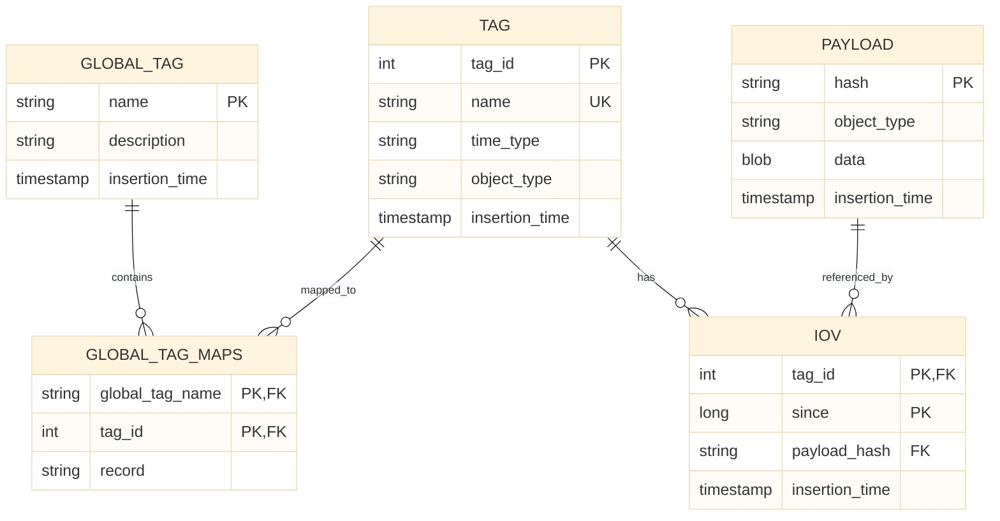

#### Author: A.Formica, R.Sipos
#### Contributors: M.Mineev, E.Alexandrov (client tools)
```
   Copyright (C) 2016  A.Formica, R.Sipos

    This program is free software: you can redistribute it and/or modify
    it under the terms of the GNU General Public License as published by
    the Free Software Foundation, either version 3 of the License, or
    (at your option) any later version.

    This program is distributed in the hope that it will be useful,
    but WITHOUT ANY WARRANTY; without even the implied warranty of
    MERCHANTABILITY or FITNESS FOR A PARTICULAR PURPOSE.  See the
    GNU General Public License for more details.

    You should have received a copy of the GNU General Public License
    along with this program.  If not, see <http://www.gnu.org/licenses/>.
```
# Table of Contents
1. [Description](#description)
2. [Data Model](#data-model-overview)
1. [Workflows](#workflows)
2. [Security](#security)

## Description
CREST service is a RESTful API for the storage and retrieval of IOVs (Interval of Validity) and payloads.
The data model is illustrated in the following diagram:



## Data Model overview
1. `TAG` : a tag is a virtual container of metadata (the `IOVs`), and is defined via the following properties
    * `name` : a string identifying the tag in a unique way
    * `description` : a general description of the tag
    * `timeType` :  the time type of the tag [time, run-lumi,...]
    * `payloadSpec` : the type of the object that the tag is associated with (a CrestContainer can generate either `crest-json-single-iov`, or `crest-json-multi-iov`)
    * `synchronization` : the synchronization of the tag, this is still to be defined, but could be `UPDX` for example (optional, can be taken from tag name).
    * `lastValidatedTime`:  The last validated time of the tag, in millisecon (optional, not used in Athena).
    * `endOfValidity` : the end of validity of the tag, in the same units as the "since" of the IOVs (see later).

2. `TAGMETA` : this object has been introduced mainly to provide a correct mapping with the existing `metadata` of `COOL`, in particular related to `channels` list and `folder` specifications. It is in one-to-one relationship with the `TAG`. It is essential to have these metadata in order to increase compatibility with COOL related code in Athena. We will provide more details below on its content. For Athena usage, it is mandatory to create a TAGMETA entry for each TAG that a user create.

2. `IOV` : the metadata represeting the start of validity for a given payload. It is defined via the following properties
    * `tagName` : the name of the tag.
    * `since` : the since of the IOV.
    * `insertionTime` : the insertion time of the IOV. Provided by the server.
    * `payloadHash` : the unique key for the payload. It is computed as the SHA256 hash of the payload by the server.
      In CREST the concept of IOV is always *open-ended*, in the sense that it is valid until the next since. The only IOV for which we foresee a possible *end time* is the last IOV; when the *end time* is not INFINITY, then it can be provided during the PAYLOAD upload. It will update the *endOfValidity* field in the TAG table. Any search functionality will in any case only use the *since* field in CREST, and eventually the *insertionTime*. The latter is used to *go back* into the history of a given *since*, in the case that it has been overridden by the expert with another PAYLOAD.

4. `PAYLOAD` : it is the binary object containing the conditions data payload. In our default serialization this is a JSON file, created with the help of `CrestContainer`. This allows to transparently migrate existing COOL data in a format that can then be used to generate a generic `CoralAttributeList` container on the Athena side. In terms of server implementation, the CREST server itself and its underlying relational DB tables are completely agnostic as far as the serialization choice of the PAYLOAD is concerned. For obvious reason, that is not at all the case on the client side, so it is important to understand the implication of the chosen serialization, and eventually adopt a strategy which is optimal for the given payload type.

The CREST API can then be seen as a *KEY=VALUE* store for PAYLOAD files. The TAG identifies a *payload type* (a combination of *folder* and *tag* in COOL), and every TAG will contain the *time history* of the PAYLOAD. When looking at the IOV in a tag, we get a unique *KEY* (the `payloadHash`) corresponding to a given time. Using that *KEY* we can download the corresponding PAYLOAD in a reproducible way, satisfying the basic principle of a REST interface.

## Workflows
The typical operational workflows can be described in the following way.
An expert having a specific payload to upload over time (a sort of conditions type) should proceed with the following 
steps in order to upload to CREST. 

- Create a `TAG` if it does not exists. 
- Upload `IOV` and `PAYLOAD` to an existing `TAG`. 
- Find an existing `TAG`. 
- Load the `IOV` for a given `TAG`. 
- Create a `GLOBALTAG`. 
- Associate a given `TAG` to one or more `GLOBALTAG`s. 
- Find a `GLOBALTAG` and retrieve the associated `TAG`s via the `GLOBALTAGMAP`.


## Security

### 1. Purpose

This document describes the security strategy applied to the CREST application, in particular the authentication and authorization model used to control access to CREST resources and tags.

### 2. Authentication

- CREST relies on the **CERN SSO** system for user authentication.
- Users are identified by their CERN (or eduGAIN) account, and authorization information is carried in a **JWT token**.
- The application acts as an **OAuth2 Resource Server**: incoming requests are authenticated by validating the JWT and converting it into a Spring Security authentication via a `JwtAuthenticationConverter`.
- Roles are declared in the official SSO / OAuth2 system.
- **Token lifetime is short**, so authorization is effectively re-evaluated frequently (see Section 4).
- **Roles are stable over time**: they typically change only when people leave the experiment or when responsibility for a given system is handed over to someone else.

#### 2.1 Roles Defined in SSO (OAuth2)

The following roles are defined in the official SSO OAuth2 configuration:

| Role name (SSO)  | Description                                          |
|------------------|------------------------------------------------------|
| `default-role`   | Default role. Users must be from CERN or eduGAIN.    |
| `crest-admin`    | CREST administrator role.                            |
| `crest-viewer`   | Viewer role for the CREST service.                   |
| `crest-expert`   | Conditions data system experts (generic role).       |
| `crest-muonalign`| Expert role for MUONALIGN.                           |
| `crest-lar`      | Expert role for LAR.                                 |
| …                | (and equivalent roles for the other subsystems)      |

### 3. Authorization Model

Authorization operates at two complementary levels:

1. **Endpoint-level authorization** – enforced by Spring Security based on the user's SSO roles.
2. **Tag-write authorization** – enforced by CREST based on the association between SSO roles and tag patterns.

#### 3.1 Endpoint-Level Authorization

When security is active, the application enforces the following rules:

| Endpoint pattern          | Required role         |
|---------------------------|-----------------------|
| `/admin/**`               | `ROLE_CREST_ADMIN`    |
| `/folders/**`             | `ROLE_CREST_ADMIN`    |
| `/globaltags/**`          | `ROLE_CREST_EXPERT`   |
| `/globaltagmaps/**`       | `ROLE_CREST_EXPERT`   |
| `/runinfo/**`             | `ROLE_CREST_TRIGGER`  |
| `/tags/**`                | `ROLE_CREST_EXPERT`   |
| `/iovs/**`                | `ROLE_CREST_EXPERT`   |
| `/payloads/**`            | `ROLE_CREST_EXPERT`   |
| `GET /**`                 | Permit all            |
| Any other request         | Authenticated         |

Additionally:

- **CSRF is disabled** for the service (it is a stateless, token-authenticated API).
- All read (`GET`) requests are permitted to everyone, consistent with the "anyone can read" policy.

#### 3.2 Role → Tag Pattern Mapping Table

Write authorization on individual tags is based on the association between SSO roles and tag patterns, stored in a dedicated table. Each row links a role (as defined in SSO) to a `CREST_TAG_PATTERN`.

| Role (SSO)         | CREST_TAG_PATTERN |
|--------------------|-------------------|
| `crest-muonalign`  | `MUONALIGN`       |
| `crest-admin`      | `%`               |
| `crest-developers` | `DEV`             |
| `crest-lar`        | `LAR`             |
| `crest-mdt`        | `MDT`             |
| `crest-tile`       | `TILE`            |
| `crest-trigger`    | `TRIGGER`         |
| `crest-tdaq`       | `TDAQ`            |
| `crest-sct`        | `SCT`             |
| `crest-tgc`        | `TGC`             |
| `crest-calo`       | `CALO`            |
| `crest-indet`      | `INDET`           |
| `crest-itk`        | `ITK`             |

#### 3.3 Authorization Rules

- **Read access**: anyone may **read** any tag. Read access is not restricted by role.
- **Write access**: a user is authorized to **write tags whose name starts with the `CREST_TAG_PATTERN`** associated with any role they hold.
    - `CREST_TAG_PATTERN` is a **prefix of the tag name**.
    - Matching is **case-insensitive**.
    - If a user holds **multiple roles**, the **union** of the permissions applies.
        - *Example:* a user in `crest-lar` and `crest-mdt` may write both `LAR*` and `MDT*` tags.
    - The `%` pattern is a **wildcard meaning "any tag"**: a member of `crest-admin` may write **any** tag.
- **Non-ATLAS users**: users who are not part of the ATLAS collaboration (but are from CERN or eduGAIN) can only **read**.

### 4. Summary of the Flow

1. User authenticates via **CERN SSO** (OAuth2) and receives a short-lived **JWT token**.
2. On each request, the JWT is validated and converted into a Spring Security authentication carrying the user's **roles**.
3. **Endpoint-level rules** (Section 3.1) are applied first.
4. For tag-write operations, the roles are looked up in the **role → tag pattern** table, and the union of the matching `CREST_TAG_PATTERN`s is used to authorize the operation.
5. Read operations are always permitted.

Because tokens are short-lived and roles are evaluated per-request, the effective permissions reflect the user's current role assignments. Given that role changes are infrequent (only on staff turnover or handover of a subsystem), this model provides an appropriate balance between security and operational simplicity.

### 5. Auditing and Logging

- The system currently logs **some** authorization-related information.
- This logging is recognized as **insufficient** and should be **enhanced**.
- The primary goal of the enhancement is to ease the identification of **"who did modifications"** — i.e. to be able to trace, for every write operation on tags, the identity of the user who performed it.
- The enhanced logging should therefore record, at minimum:
    - the user identity (CERN account / SSO subject),
    - the roles held at the time of the operation,
    - the operation performed (create / update / delete),
    - the tag(s) affected,
    - a timestamp,
    - the outcome (allowed / denied).

---

### 6. Points Still Open / To Clarify

1. **Exact role list in SSO** – Only a subset of the SSO roles is listed (`default-role`, `crest-admin`, `crest-viewer`, `crest-expert`, `crest-muonalign`, `crest-lar`, …). The full list should be enumerated, together with their descriptions.
2. **Handling of `crest-viewer` and `crest-expert`** – `crest-expert` is used at the endpoint level, but does not (yet) appear in the role → tag-pattern table. Its write semantics at the tag level should be clarified, as should the intended use of `crest-viewer`.
3. **`default-role` semantics** – It is stated that users must be from CERN or eduGAIN. It should be confirmed whether `default-role` implies read-only access for any CERN/eduGAIN user.
4. **Pattern matching details** – Although case-insensitivity and prefix semantics are confirmed, any special handling (e.g. escaping, treatment of `%` in non-admin patterns) should be stated formally.
5. **Logging enhancement plan** – The precise scope of the planned enhancement (fields to log, retention period, access to logs, storage location) is not yet defined.
6. **Role handover process** – Since role changes happen on staff turnover or subsystem handover, the process by which roles are granted/revoked in SSO should be referenced (even if outside the scope of CREST itself).

---

